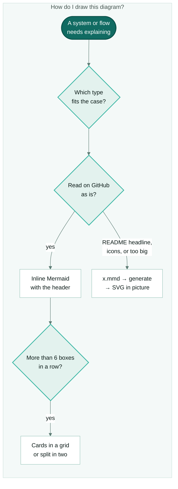

# diagram-authoring — Mermaid in the house theme

The single source of truth for **how this plugin draws diagrams**. The plugin writes markdown
artifacts (`/board plan` docs, epic/issue bodies, handoffs, status updates, `KNOWLEDGE.md`,
README, blog entries). Their destinations — GitHub markdown and Claude Code / claude.ai
artifacts — render **Mermaid** natively, so a diagram-as-code block costs nothing extra and reads
far better than ASCII. Every diagram uses the **house theme** below unless the user asks for
another look.

## Core rule

When you are about to put a diagram into any plugin-produced markdown artifact, emit a fenced
**Mermaid** block **opened with the house header**. **Never hand-draw ASCII art for a graph**
(boxes of `+--+`, `│`, `└──▶`): it wraps badly, doesn't diff and doesn't scale.

Get the header from the plugin script (it prints the `%%{init}%%` line and, for a flowchart, the
standard `classDef`s):

```powershell
pwsh "${CLAUDE_PLUGIN_ROOT}/scripts/Diagram-Theme.ps1" header                       # flowchart TB
pwsh "${CLAUDE_PLUGIN_ROOT}/scripts/Diagram-Theme.ps1" header -Type sequenceDiagram  # any other type
```

No PowerShell at hand? Copy the literal header from
[references/house-style.md](references/house-style.md#the-header). Never write loose colors: they
live in [theme.json](theme.json).

## 1. Pick the type for the case

| You are explaining… | Use |
|---|---|
| Messages between actors over time (an idea to a merged PR, an API call) | `sequenceDiagram` inside a `box`, with `autonumber` and `alt` |
| A system: its pieces, where they live, what connects to what | `architecture-beta` with built-in icons inline; brand icons → SVG |
| Storage, layers or groups of things | `flowchart TB` with `subgraph` cards |
| Everything a topic covers, with no flow | `mindmap` |
| Dated milestones / phases | `timeline`, **without** `title` (the title goes in the `.md` heading) |
| A flow / pipeline / decision path | `flowchart TB` (`LR` only for a chain of 5 steps or fewer) |
| States and transitions | `stateDiagram-v2` |
| Entities and relations | `erDiagram` |
| Work items by column | `kanban` |

A flow is not a sequence, a hierarchy is not an ER model. If two fit, pick the one a reader of
that artifact understands in five seconds.

## 2. The house theme — classes

A flowchart header brings these classes. Assign them with a `class` line at the end.

| Class | For |
|---|---|
| `frame` | The outer `subgraph`: the card with a background and the diagram's title around everything |
| `card` | Each inner `subgraph`: a group of things that belong together |
| `start` | The starting point (one per diagram) |
| `branch` | An intermediate node that fans out or decides |
| `leaf` | What hangs at the end |
| `warn` | A limit, a warning, something that fails |
| `external` | What isn't ours: another tool, a service, the person, GitHub |

Never name a class after Mermaid's own SVG classes (`root`, `node`, `cluster`, `edge`, `label`):
`classDef root` also matches the diagram's top-level `<g class="root">` and paints every arrow as
a filled shape.

## 3. Shape rules

- **Vertical first:** `flowchart TB`.
- **At most 5–6 boxes per row.** More children go inside a `card` laid out as a grid with
  invisible links: under `direction LR`, `a ~~~ b ~~~ c` is a row of three. The arrow points at
  the card, not at each leaf.
- **Always a `frame` card** with the diagram's title, and `direction TB` inside it (without it
  Mermaid turns the subgraph sideways). On GitHub's dark mode the frame is a light card on the
  dark page, so the diagram stays readable — GitHub does not adapt `init` colors to dark mode.
  The empty strip under the frame's title also keeps GitHub's zoom buttons (top right, which can't
  be removed) off the first node.
- **Shapes that mean something** (`id@{ shape: … }`): `cyl` a store, `hex` a transforming step,
  `docs` several documents, `([…])` an action you invoke. Put the class on a `class` line:
  `:::` after `@{…}` does not parse.
- **Sequences:** wrap all participants in `box rgb(244,249,248) <title>`. Without the box, the
  message text is black on black in dark mode.
- **Split** anything past ~15 nodes or 3 levels: one diagram per idea.
- **Words from the screen**, short labels, `<br/>` to break a label in two lines.

A full worked example of each type is in [references/house-style.md](references/house-style.md).

## 4. Inline Mermaid or a generated SVG

| Case | Use |
|---|---|
| Issue, PR, plan, handoff, `SKILL.md`, `KNOWLEDGE.md`: read on GitHub | Inline Mermaid with the header |
| A README's headline diagram, one people will open large, or one that must look identical in light and dark | Generated SVG with `<picture>` and the view / download links |
| Brand / Material icons (`logos:`, `mdi:`) | Generated SVG (inline they render as "?") |
| A diagram that won't fit vertically and GitHub shrinks it unreadable | Split it; if you can't, a generated SVG |
| Goes to a website, a document or a slide | Generated SVG |

The SVG comes from an **unthemed `.mmd`** next to it (the script adds the theme):

```powershell
pwsh "${CLAUDE_PLUGIN_ROOT}/scripts/Diagram-Theme.ps1" generate -Root .   # each x.mmd -> x-light.svg + x-dark.svg
pwsh "${CLAUDE_PLUGIN_ROOT}/scripts/Diagram-Theme.ps1" check -Root .      # browser-free: exit 1 if one is stale or hand-edited
```

`generate` needs Node (it runs `@mermaid-js/mermaid-cli` through `npx`, the version pinned in
`theme.json`; ~45 s the first time). `check` needs neither Node nor a browser, so it runs inside
the repo's existing test job instead of a workflow of its own. The `.mmd` is the source; an SVG
is **never** edited by hand — it carries a stamp that `check` verifies. Link it with relative
paths:

```html
<p align="center">
  <a href="diagrams/x-light.svg?raw=true"><picture>

    <source media="(prefers-color-scheme: dark)" srcset="diagrams/x-dark.svg">
    
  </picture></a>
</p>

<p align="center">
  <a href="diagrams/x-light.svg?raw=true">🔍 View full size</a> ·
  <a href="diagrams/x-light.svg?raw=true">⬇ Download SVG (light)</a> ·
  <a href="diagrams/x-dark.svg?raw=true">⬇ Download SVG (dark)</a>
</p>
```

The image and "View full size" open the raw SVG (`?raw=true`): the browser shows it alone,
filling the window, and **Back** returns to the page. Do not link the plain file path: GitHub's
file page shows the SVG as a small thumbnail inside its own UI. The two download links open the
raw file of each mode; GitHub strips the `download` attribute and `target`, so the browser opens
it and Save (Ctrl+S) keeps it. Keep the links relative so they work on every branch, not only
after the file reaches `main`.

**Inline Mermaid has its own enlarged viewer, and it can trap the reader** (checked on GitHub,
light and dark, 2026-10-27). The viewer's X is at the top of a dialog that scrolls with the
diagram: after clicking or scrolling inside a tall diagram, the X is out of view, and Esc stops
working because focus is inside the diagram frame. What always closes it: **click outside the
dialog**, or scroll the dialog back to the top and press the X. This is GitHub's viewer, not
something a repo can fix. So a diagram people will open large (a README headline, anything
taller than one screen) goes out as a generated SVG with "View full size", not inline.

**Brand.** Every generated SVG carries the repo's mark in its bottom-right corner (a footer strip
outside the `frame` card, in the mode's `brandColor`). Per repo, in `.github/diagram-brand.json`:

```json
{ "text": "my-repo · my-org", "icon": ".github/assets/diagrams/brand-icon.png" }
```

`icon` is a small PNG (64 px is plenty; it is embedded as base64) and is optional. Without the
file, the mark is `<repo> · <owner>` from the `origin` remote. `{ "enabled": false }` turns it off.
Changing the brand makes every SVG stale, so `check` asks to regenerate.

## 5. What GitHub draws (viewer on Mermaid 12.2.0)

| Feature | Inline on GitHub | Generated SVG |
|---|---|---|
| `flowchart`, `@{ shape }`, `sequenceDiagram`, `mindmap`, `timeline`, `block`, `kanban`, C4 | yes | yes |
| `architecture-beta` with built-in icons (`cloud`, `server`, `disk`, `database`, `internet`) | yes | yes |
| Icon packs `logos:`, `mdi:`, `fa:` | no — drawn as "?" | yes |
| `layout: elk` | no — silently falls back | no |
| `themeCSS` in the `init` | no — stripped | yes (the script uses it) |
| Colors that switch with dark mode | no | yes, via `<picture>` |

To see which Mermaid version a page gets, put a block with just `info` in it.

## Escalation — when Mermaid is not enough

Reach for **D2 (Terrastruct)** or **Graphviz/DOT** only when a graph is too dense for Mermaid to
stay legible even split (large dependency graphs, many crossing edges). They don't render inline
on GitHub: render via **Kroki** (`https://kroki.io/`) to an SVG and embed the image. With no render
path, fall back to a simpler Mermaid approximation — never ship ASCII art as the fallback.

## Anti-invention rule

A diagram documents the **real system**. Do not invent nodes, edges, states or actors to make a
picture look complete. Every box and arrow must match something that exists in the code, flow or
data being described — read the source first. If unsure a relationship exists, leave it out or
ask.

## Validation checklist (before saving)

- [ ] The block opens with ` ```mermaid ` + the house header, and is **closed** with ` ``` `.
- [ ] The type matches the case (section 1); a flowchart is `TB` with a `frame` card.
- [ ] No row has more than 6 boxes; past ~15 nodes it is split.
- [ ] Node IDs have **no spaces** — quote labels instead: `A["work branch"]`.
- [ ] Arrows are valid for the type (`-->`, `-.->`, `==>`; `->>` / `-->>` in sequences).
- [ ] `subgraph` / `end` and every `[`, `(`, `{`, `"` are balanced.
- [ ] No loose colors, no icon packs inline, no `layout: elk`.
- [ ] The diagram reflects the real system (anti-invention rule).
- [ ] When in doubt it parses, render once (a Claude artifact, or `generate`) before saving.
- [ ] Generated SVGs: `check` passes, the `` has an `alt` that says what it shows, the
      image links to full size, and the view / download line sits under it.

## Data flow



## Relation to other skills

- Artifact-producing skills (`projects-admin` for `/board plan` + handoff, `knowledge-registry`)
  carry a one-line pointer here so the rule fires without being duplicated — this file stays the
  only place the diagram guidance lives.
- The **Diagrams** knowledge domain (the agentic-board repo's knowledge registry) catalogues the
  tools referenced above (Mermaid, D2, Graphviz, Kroki). Graphify is a separate knowledge-graph
  tool, catalogued but not a diagram authoring tool.
