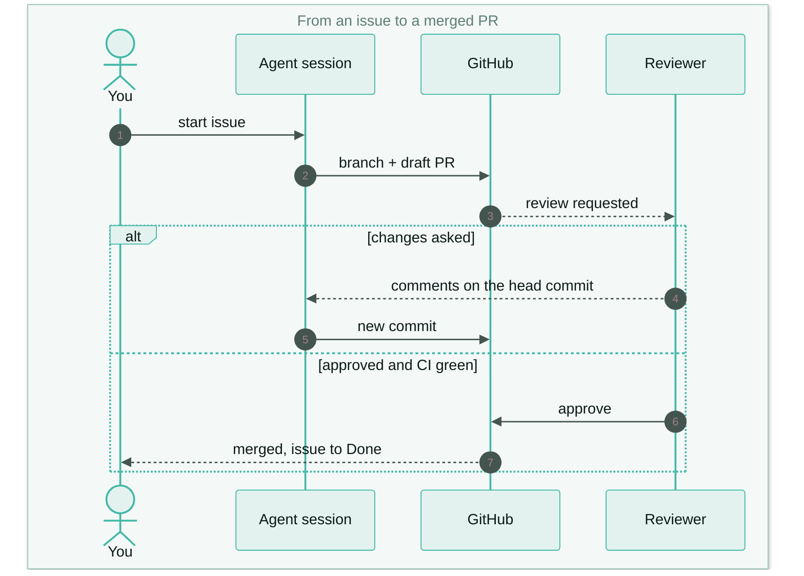
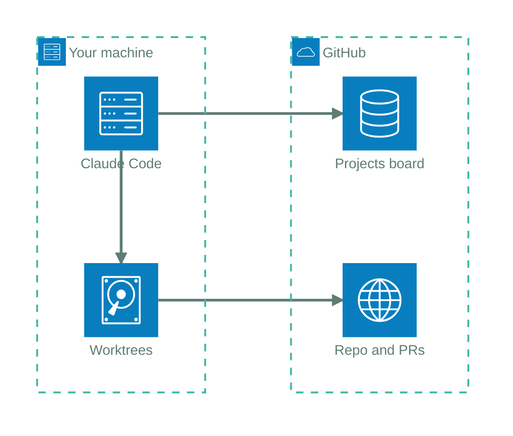
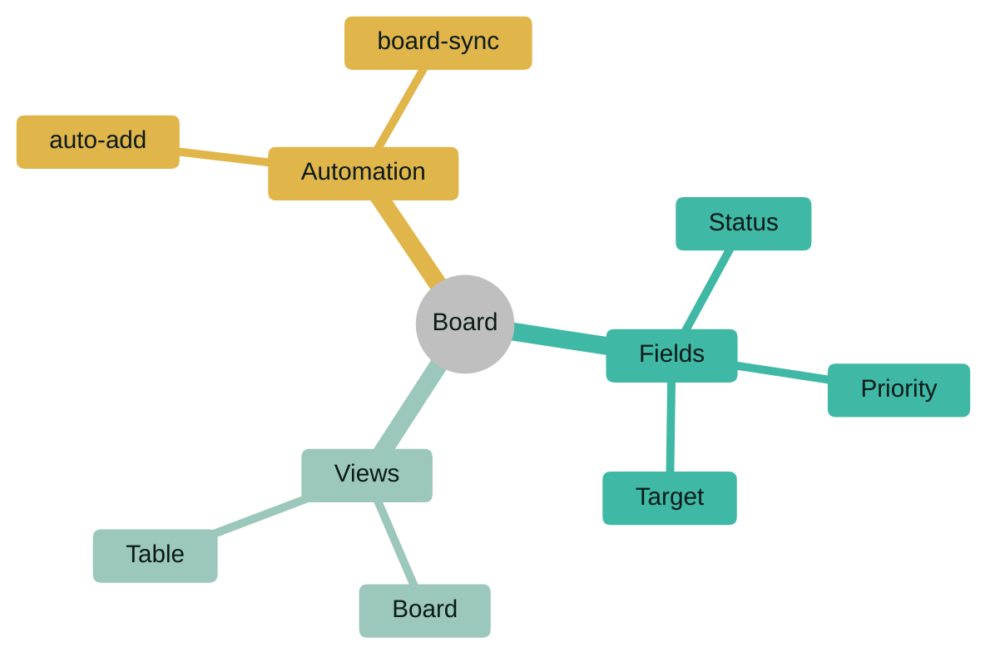
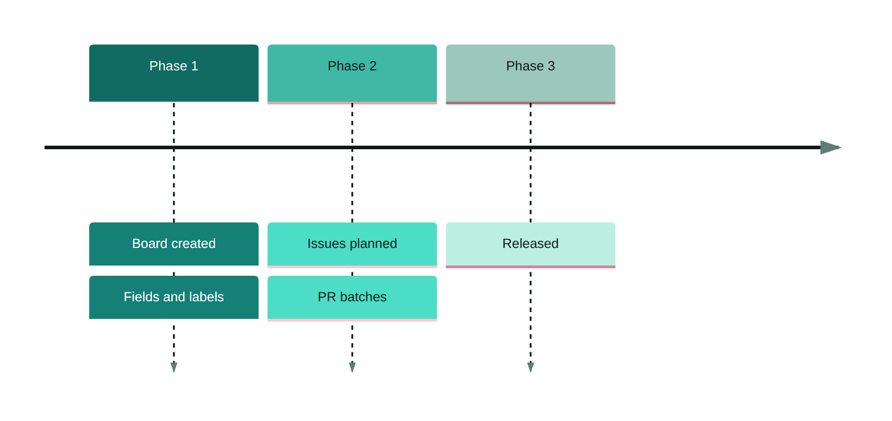
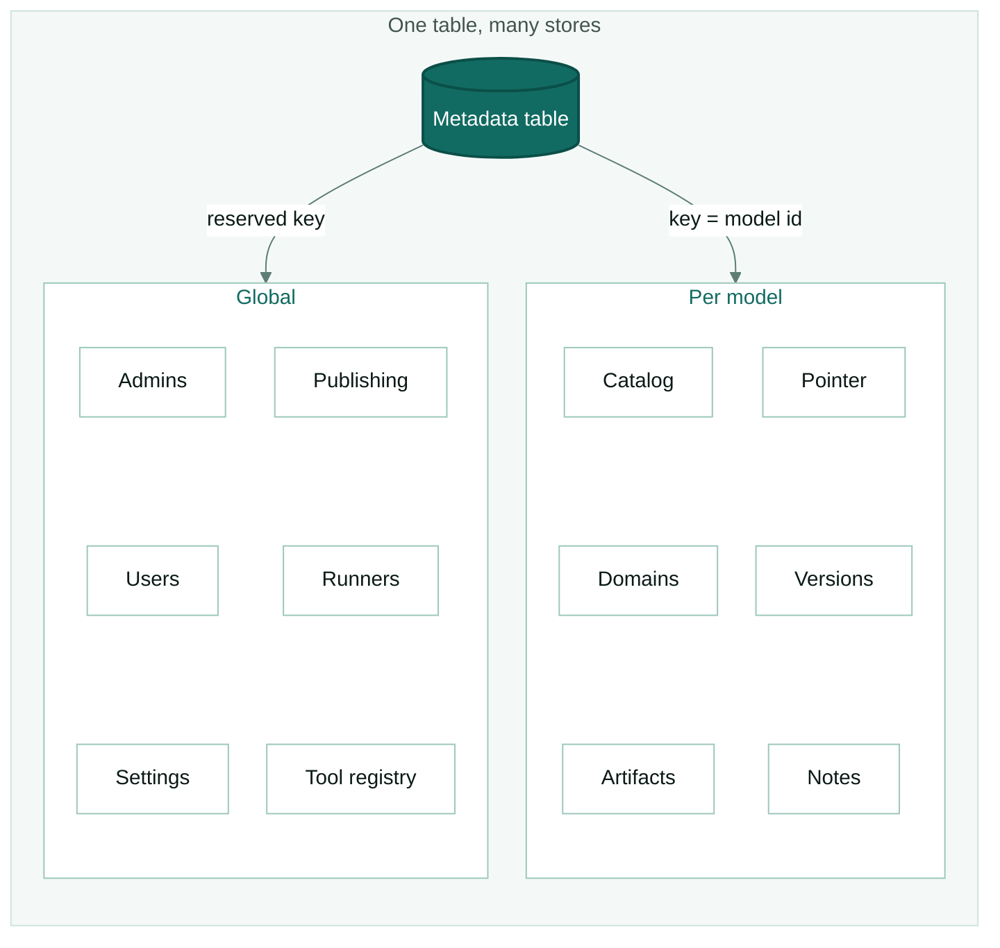

# House style — header and worked examples

Companion to [../SKILL.md](../SKILL.md). Everything here was checked against **Mermaid 12.2.0**,
the version GitHub's viewer uses (an `info` block shows the version a page gets).

## The header

What `Diagram-Theme.ps1 header` prints. Paste it as the first lines of a ` ```mermaid ` block.

**Flowchart** (init + diagram type + classes):

```text
%%{init: {"theme":"base","themeVariables":{"actorBkg":"#E3F2EE","actorBorder":"#3FB8A6","actorTextColor":"#0B1A17","archEdgeArrowColor":"#5E7D75","archEdgeColor":"#5E7D75","archGroupBorderColor":"#3FB8A6","background":"#F4F9F8","clusterBkg":"#EAF4F1","clusterBorder":"#9CC7BC","cScale0":"#116B62","cScale1":"#3FB8A6","cScale2":"#9CC7BC","cScale3":"#E0B54A","cScale4":"#5E7D75","cScale5":"#CFE3DD","cScale6":"#2C7D71","cScale7":"#E3F2EE","cScaleLabel0":"#FFFFFF","cScaleLabel1":"#0B1A17","cScaleLabel2":"#0B1A17","cScaleLabel3":"#0B1A17","cScaleLabel4":"#FFFFFF","cScaleLabel5":"#0B1A17","cScaleLabel6":"#FFFFFF","cScaleLabel7":"#0B1A17","edgeLabelBackground":"#FFFFFF","fontFamily":"Segoe UI, Roboto, Helvetica, Arial","fontSize":"15px","lineColor":"#5E7D75","noteBkgColor":"#FFF6E0","noteBorderColor":"#E0B54A","noteTextColor":"#0B1A17","primaryBorderColor":"#9CC7BC","primaryColor":"#FFFFFF","primaryTextColor":"#0B1A17","secondaryColor":"#E3F2EE","signalColor":"#44544F","signalTextColor":"#0B1A17","tertiaryColor":"#F4F9F8","textColor":"#5E7D75","titleColor":"#0B1A17"},"flowchart":{"curve":"basis","nodeSpacing":28,"rankSpacing":44,"padding":14}}}%%
flowchart TB
    classDef frame fill:#F4F9F8,stroke:#CFE3DD,stroke-width:1px,color:#44544F
    classDef card fill:#FFFFFF,stroke:#9CC7BC,stroke-width:1px,color:#116B62
    classDef start fill:#116B62,stroke:#0B4F48,stroke-width:2px,color:#FFFFFF
    classDef branch fill:#E3F2EE,stroke:#3FB8A6,stroke-width:2px,color:#0B1A17
    classDef leaf fill:#FFFFFF,stroke:#9CC7BC,stroke-width:1px,color:#0B1A17
    classDef warn fill:#FFF6E0,stroke:#E0B54A,stroke-width:1px,color:#5C4300
    classDef external fill:#F4F9F8,stroke:#93A8A2,stroke-width:1px,stroke-dasharray:4 3,color:#44544F
```

**Any other type** — the same `%%{init}%%` line, then the type keyword (`sequenceDiagram`,
`architecture-beta`, `mindmap`, `timeline`, `stateDiagram-v2`, `erDiagram`, `kanban`).
Classes only apply to flowcharts:

```text
%%{init: {"theme":"base","themeVariables":{"actorBkg":"#E3F2EE","actorBorder":"#3FB8A6","actorTextColor":"#0B1A17","archEdgeArrowColor":"#5E7D75","archEdgeColor":"#5E7D75","archGroupBorderColor":"#3FB8A6","background":"#F4F9F8","clusterBkg":"#EAF4F1","clusterBorder":"#9CC7BC","cScale0":"#116B62","cScale1":"#3FB8A6","cScale2":"#9CC7BC","cScale3":"#E0B54A","cScale4":"#5E7D75","cScale5":"#CFE3DD","cScale6":"#2C7D71","cScale7":"#E3F2EE","cScaleLabel0":"#FFFFFF","cScaleLabel1":"#0B1A17","cScaleLabel2":"#0B1A17","cScaleLabel3":"#0B1A17","cScaleLabel4":"#FFFFFF","cScaleLabel5":"#0B1A17","cScaleLabel6":"#FFFFFF","cScaleLabel7":"#0B1A17","edgeLabelBackground":"#FFFFFF","fontFamily":"Segoe UI, Roboto, Helvetica, Arial","fontSize":"15px","lineColor":"#5E7D75","noteBkgColor":"#FFF6E0","noteBorderColor":"#E0B54A","noteTextColor":"#0B1A17","primaryBorderColor":"#9CC7BC","primaryColor":"#FFFFFF","primaryTextColor":"#0B1A17","secondaryColor":"#E3F2EE","signalColor":"#44544F","signalTextColor":"#0B1A17","tertiaryColor":"#F4F9F8","textColor":"#5E7D75","titleColor":"#0B1A17"},"flowchart":{"curve":"basis","nodeSpacing":28,"rankSpacing":44,"padding":14}}}%%
sequenceDiagram
```

## Worked examples

Each block below renders on GitHub as is. They are shapes to copy, not facts about a project:
replace every label with the real thing (anti-invention rule).

### Sequence — actors over time

All participants inside a `box` (without it the message text is unreadable in dark mode),
`autonumber`, and `alt` for the branch.



### Architecture — pieces of a system

Built-in icons only (`cloud`, `server`, `disk`, `database`, `internet`); icon packs need a
generated SVG.



### Mindmap — everything a topic covers



### Timeline — dated phases

No `title`: on GitHub's dark mode the timeline title is unreadable; the `.md` heading names it.



### Flowchart — a wide branch made vertical

Twelve leaves in one row is the failure this style exists for: GitHub shrinks it until nothing is
readable and its zoom buttons cover the first node. Here each branch is a `card` laid out as a
grid of two rows of three (invisible links `~~~` under `direction LR` make a row), and the arrow
points at the card.



## Findings behind the rules

Each rule in the skill comes from something that broke when tested:

- **Font.** Mermaid silently drops a `fontFamily` that contains a hyphenated generic
  (`sans-serif`, `system-ui`, `-apple-system`); the SVG then comes out serif. The theme names
  concrete families only.
- **Dark mode.** GitHub does not adapt `init` colors to dark mode. The light `frame` card keeps a
  flowchart readable; sequences need the `box`; `textColor` is a mid tone (#5E7D75) because
  architecture labels and loose text sit straight on the page.
- **Sideways subgraphs.** A `subgraph` without `direction TB` gets laid out horizontally.
- **Class names.** `classDef root` matches Mermaid's own top-level `<g class="root">` and fills
  every arrow as a solid shape. Same risk for `node`, `cluster`, `edge`, `label`.
- **SVG labels.** A generated SVG served as an `` loses foreignObject HTML, so the script
  renders labels as `<text>` (`htmlLabels: false`) with a wide `wrappingWidth`; break lines with
  `<br/>` yourself.
- **What GitHub strips.** `themeCSS` in the `init`, icon packs and `layout: elk` are dropped
  inline without a warning.
